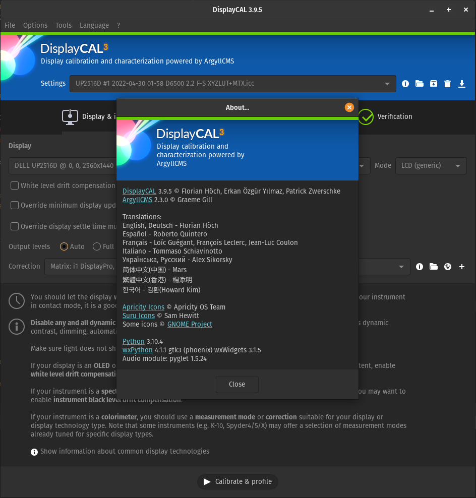

DisplayCAL Python 3 Project
===========================

This project intended to modernize the DisplayCAL code including Python 3 support.

Florian Höch, the original developer, did an incredible job of creating and maintaining
DisplayCAL for all these years. But, it seems that, during the pandemic, very
understandably, he lost his passion to the project. Now, it is time for us, the
DisplayCAL community, to contribute back to this great tool.

This project is based on the ``HEAD`` of the Sourceforge version, which had 5 extra
commits that Florian has created over the ``3.8.9.3`` release on 14 Jan 2020.

Thanks to all the efforts put by the community DisplayCAL is now working with Python
3.11+:

New Qt User Interface
=====================

DisplayCAL 3.10 comes with a new user interface built with Qt, next to the classic
wxPython one. The plan is:

- **3.10.x**: wxPython stays the default, the Qt UI is opt-in.
- **3.11.x**: the Qt UI becomes the default, wxPython is still available.
- **4.0.0**: Qt only.

To try it, accept the offer DisplayCAL shows on startup, or enable
**Options > Advanced > Use Qt user interface (experimental)** and restart DisplayCAL.
You can switch back the same way from the Qt UI. The `--qt` / `--wx` command line
flags and the `DISPLAYCAL_UI=qt` / `DISPLAYCAL_UI=wx` environment variable override
the setting for a single launch.

If something looks or behaves differently from the wxPython UI, please
[open a bug report](https://github.com/eoyilmaz/displaycal-py3/issues/new?template=bug_report.yml)
and choose "Qt" as the user interface.

Installation Instructions
=========================

Follow the instructions depending on your OS:

- [Windows](docs/install_instructions_windows.md)
- [MacOS](docs/install_instructions_macos.md)
- [Linux](docs/install_instructions_linux.md)

Have fun!
