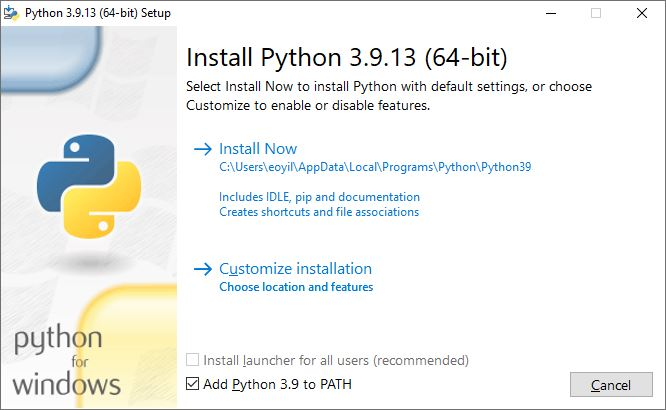
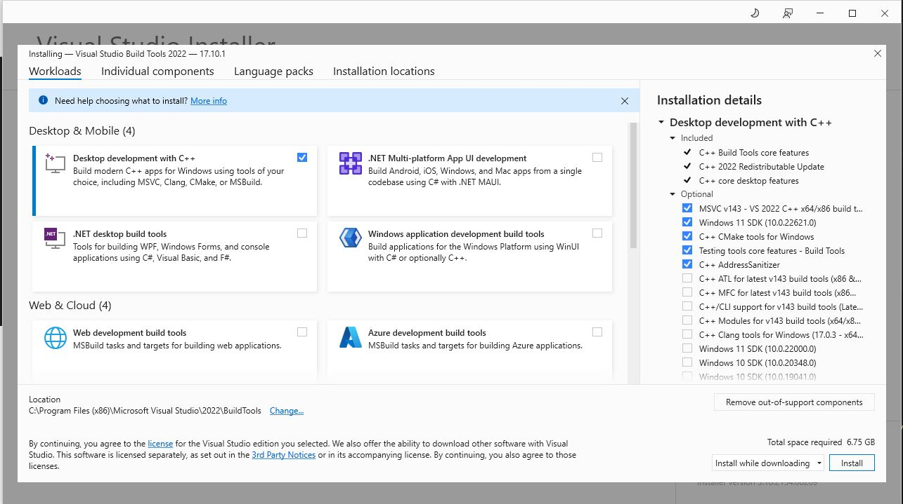

Installation Instructions (Windows)
===================================

ArgyllCMS Requirement
----------------------

DisplayCAL relies on [ArgyllCMS](https://www.argyllcms.com/) to talk to your
measurement instrument and take the actual readings, it is not bundled with the
installer or any of the install methods described below and needs to be obtained
separately.

You don't have to grab it upfront though. The first time you launch DisplayCAL and it
can't find a working ArgyllCMS installation, it will offer to either **download** a
matching build for you automatically (from
[eoyilmaz/argyllcms-binaries](https://github.com/eoyilmaz/argyllcms-binaries/releases)),
or **browse** to an existing installation already on your system.

If you'd rather install it yourself first, that works too, DisplayCAL will pick it up
automatically if it's on your `PATH`. Otherwise, point DisplayCAL at its `bin` folder
via *File -> Locate ArgyllCMS executables...* whenever you need to change it.

Install with Installer
----------------------

We now have a proper [installer](https://www.github.com/eoyilmaz/displaycal-py3/releases) for Windows
and this is the preferred way of running DisplayCAL under Windows (unless you want to
test the latest code). Each release publishes two installers, pick the one matching your
system:

* `DisplayCAL-<version>-Windows-x64.exe`, for regular 64-bit (x86_64) Windows systems
* `DisplayCAL-<version>-Windows-arm64.exe`, for Windows on ARM (e.g. Snapdragon-based
  laptops)

> [!NOTE]
> ArgyllCMS 3.5.0 adds native Windows ARM64 binaries (`Argyll_V3.5.0_win_arm64_exe.zip`)
> in addition to x86/x64 builds. DisplayCAL download handling supports this now.
> On ARM64 systems, instrument USB driver setup can still need extra manual steps.

Install through PyPI
--------------------

If you desire so, you can install DisplayCAL through PyPI. Use Python 3.11 to 3.14
and create a dedicated virtual environment to avoid package conflicts with other Python
programs. Here is the installation procedure:

1- Download and install a supported Python release from
   [Python.org](https://www.python.org/downloads/windows/).

   Also don't forget to select "Add Python 3.xx to PATH" in the installer.

   

2- Download and install Visual Studio Build Tools:

   Download from https://visualstudio.microsoft.com/visual-cpp-build-tools/

   Select "Desktop development with C++" only:

   

3- Create and activate a virtual environment:

   After both Python and Visual Studio Build Tools are installed run the following in
   the command prompt:

   ```shell
   py -3.11 -m venv %USERPROFILE%\venv-displaycal
   %USERPROFILE%\venv-displaycal\Scripts\activate
   pip install --upgrade pip
   pip install displaycal
   ```

   If you installed a different Python version, replace `-3.11` accordingly.

4- Run DisplayCAL:

   ```shell
   python -m DisplayCAL
   ```

If you close the current terminal and open a new one, activate the same virtual
environment again before calling `python -m DisplayCAL`:

```shell
%USERPROFILE%\venv-displaycal\Scripts\activate
```

> [!WARNING]
> Under Windows don't run DisplayCAL inside the IDE (Vscode, Pycharm etc.) terminal as
> most of the IDE's are creating virtual terminals and it is not possible to capture the
> command outputs with Wexpect.

Build From Source
-----------------

Under Windows the `makefile` workflow will not work. Build from source in a virtual
environment to keep dependencies isolated from your system Python installation.
Currently, DisplayCAL supports Python 3.11 to 3.14. To build DisplayCAL from source under
Windows follow these steps:

1- Download and install a supported Python release from
   [Python.org](https://www.python.org/downloads/windows/).

   Also don't forget to select "Add Python 3.xx to PATH" in the installer.

   

2- Download and install Visual Studio Build Tools:

   Download from https://visualstudio.microsoft.com/visual-cpp-build-tools/

   Select "Desktop development with C++" only:

   

3- Download and install Git:

   https://www.git-scm.com/download/win

   When installer asks, the default settings are okay.

4- Clone DisplayCAL repository and create a virtual environment:

   Open up a command prompt and run the following:

   ```shell
   cd %HOME%
   git clone https://github.com/eoyilmaz/displaycal-py3.git
   cd displaycal-py3
   ```

   Then we suggest switching to the `develop` branch as we would have fixes introduced
   to that branch the earliest. To do that run:

   ```shell
   git checkout develop
   ```

  > [!TIP]
  > If you want to switch to some other branches to test the code you can replace
  > `develop` in the previous command with the branch name:
  > ```shell
  > git checkout 367-compiled-sucessfully-in-w10-py311-but-createprocess-fails-call-to-dispread-to-measure
  > ```

   Create and activate a virtual environment in the project folder:

   ```shell
   py -3.11 -m venv .venv
   .venv\Scripts\activate
   pip install --upgrade pip
   ```

   If you installed a different Python version, replace `-3.11` accordingly.

   Let's install the requirements, build displaycal and install it:

   ```shell
   pip install -r requirements.txt -r requirements-dev.txt
   python -m build
   for /r dist %f in (DisplayCAL-*.whl) do pip install "%f"
   ```

5- Run DisplayCAL:

   ```shell
   python -m DisplayCAL
   ```

6- To rebuild and install it again:

   First remove the old installation:

   ```shell
   pip uninstall displaycal
   ```

   Build and install it again:

   ```shell
   python -m build
   for /r dist %f in (DisplayCAL-*.whl) do pip install "%f"
   ```

Build The Installer
-------------------

To build the installer for your own use you can follow these steps:

1- Follow the instructions explained in
   [Build From Source](#build-from-source) to build DisplayCAL from
   its source.

2- Use the `DisplayCAL\freeze.py` script to generate the frozen executables. Under the
   `displaycal-py3` folder run the following:

   ```shell
   python DisplayCAL\freeze.py
   ```

   This should generate a folder under the `dist` folder with a name similar to
   `py2exe.win32-py3.xx-DisplayCAL-<version>`.

   All the executables and resources to run DisplayCAL are placed under this folder. So,
   you can directly run the executables under this folder.

3- Download and install [Inno Setup](https://jrsoftware.org/isdl.php#stable):

4- Generate the Inno Setup script:

   ```shell
   python native_build.py inno
   ```

   This will generate a file called `DisplayCAL-Setup-py2exe.win-amd64-py3.11.iss`

5- Run Inno Setup to build the script:

   ```shell
   cd dist
   iscc DisplayCAL-Setup-py2exe.win-amd64-py3.11.iss
   ```

6- This should now generate an installer with a name similar to
   `DisplayCAL-<version>-Setup.exe` that you can use to install DisplayCAL
   to any Windows computer.
